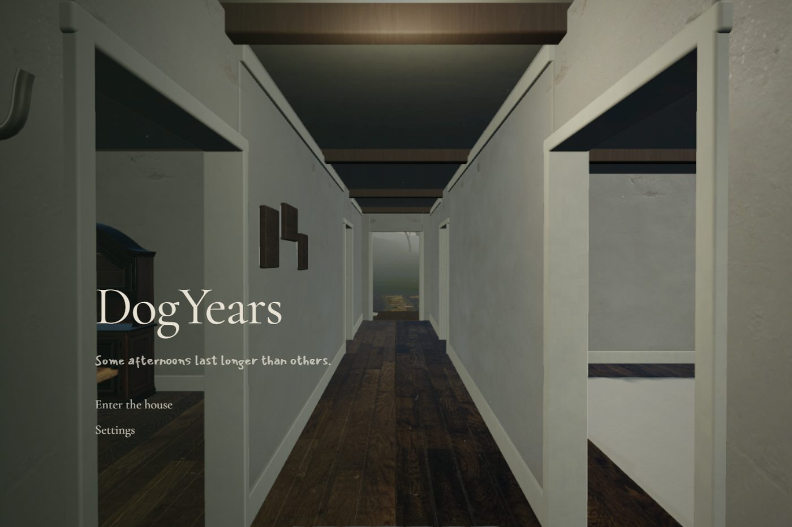
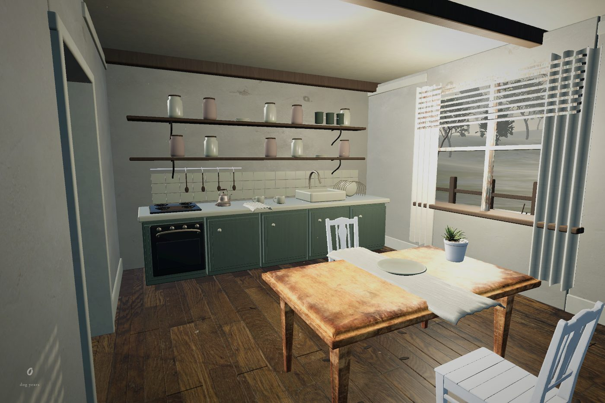
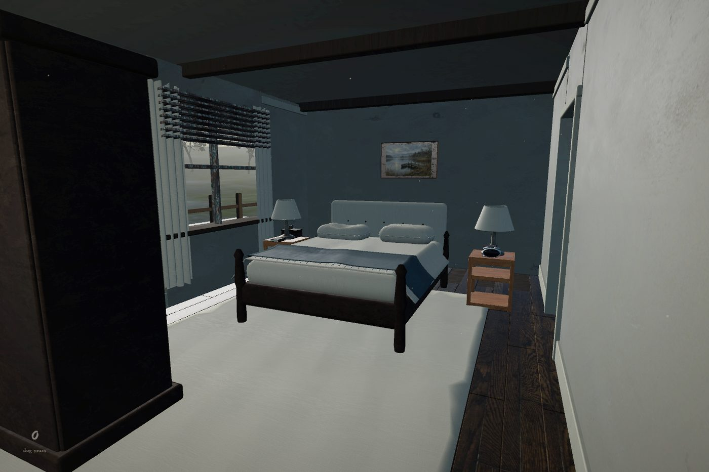
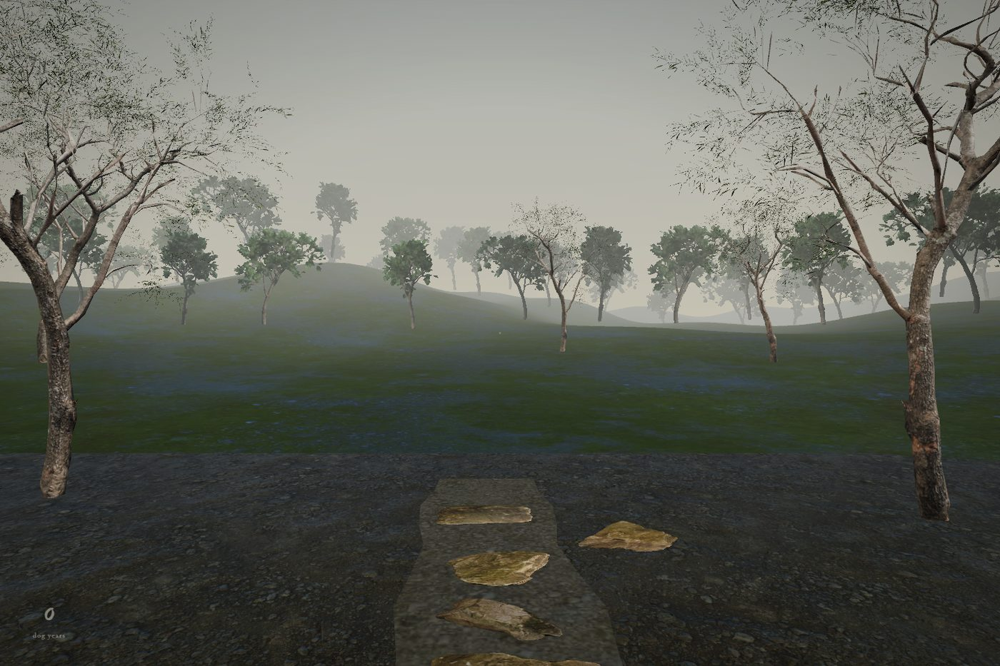
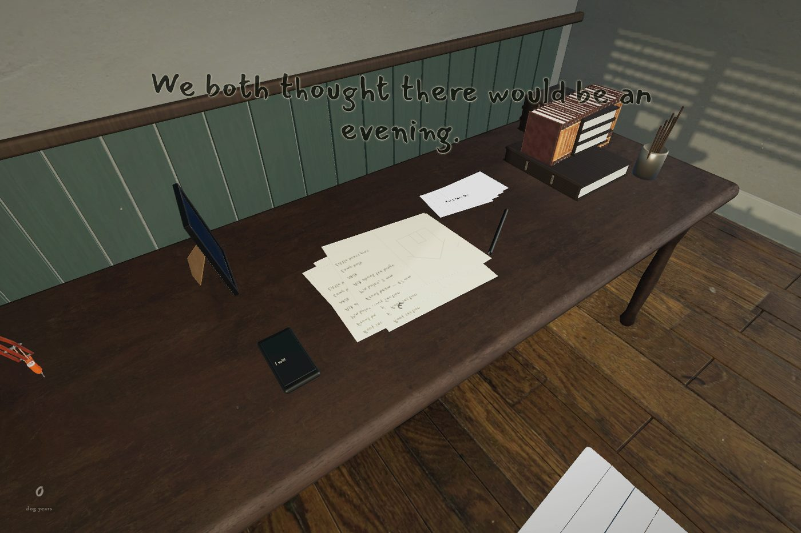

# DogYears

A playable first-person narrative game about the afternoons after a loss.

<table>
<tr>
<td></td>
<td></td>
</tr>
<tr>
<td></td>
<td></td>
</tr>
</table>

Open **http://localhost:5174/** while the local server is running. To start the built version later, run `pnpm build` once and then double-click **启动游戏.cmd** (requires Node.js). All player-facing text is English. There is no model-viewer sidebar or room-selection interface in the game.

## Playing

- **W A S D** — walk; **mouse** — look. **Shift** slows your steps.
- **E** — touch an object. While holding it, drag to turn it; **E** enters the memory, **R** puts it down.
- In memories, approach the indicated part of the room and **hold E** for a physical gesture. Release E between gestures. **R** leaves early.
- Decide whether to leave an object, make room, or take it with you. The room changes with the decision.
- The bed advances to the next morning. The front door and quiet chair let you wait.
- **P** — read the old phone. Ellis's archive and Mara's living conversation have separate threads.
- **Esc** — pause, change settings, or begin again. Saves are local to this browser.

Mouse sensitivity, field of view, mouse smoothing, sound and reduced graphics are adjustable. Head movement is off by default. The game caches slowly moving sun shadows and can reduce ambient occlusion when sustained frame time is high.

## This build

Seven authored chapters contain twenty staged memories, eight keepsakes, twenty-four optional household observations, evolving messages, three object decisions and five endings. The same room and gesture acquire different meanings as the week progresses. The day-five attempt to finish a miniature leads to a concrete request for help and the last-day act of holding a door for a living friend. The playable screenplay is in `src/story.js`; narrative direction and revisions are in `docs/STORY.md`.

Narrative lines occupy three-dimensional space near their objects, with parallax, depth occlusion and short reading intervals. There is no mission panel, checklist, room-selection interface or screen progress bar. The phone, pause screen and object decisions retain minimal functional interfaces.

## Typography

Two bundled faces carry the writing. Cormorant Garamond sets the book text, the menus and the phone. Mansalva, a dense crowded hand, writes the memory lines, the day card, the decision lines and the small prompts. A memory line is drawn into a 2048×640 canvas and placed as a billboard near its object, so the type is real geometry with parallax and depth occlusion instead of a screen overlay.

Both families are under the SIL Open Font License and ship with their licences in `public/fonts`. The face was chosen by rendering the same line in each candidate and photographing it inside the actual room before adoption; `tools/fetch_font_options.mjs`, `tools/fetch_elegant_options.mjs`, `tools/fetch_cramped_fonts.mjs` and `tools/scene_font_compare.mjs` reproduce that comparison. Changing the handwriting face means editing one `@font-face` block in `src/type.css` and the canvas font string in `src/spatial-text.js`.

The art revision combines artist-authored furniture and scanned PBR surfaces with original story props and fitted garments. Worn joinery, fabric weave, ceramic surfaces and peeling paint use distinct material treatment. Curtains and blinds interrupt the moving sun; a photographed HDR environment supplies indirect illumination.

This is a playable production iteration. It does not yet represent a four-to-five-hour commercial release. Memories occur in the house; remembered dialogue uses short spatial captions, without recorded actors or cinematic character performances.

The house has connected rooms and a walkable back garden. The scenery includes a yard, stones, fence, vegetation, distant tree lines and multiple three-dimensional terrain ridges. The previous house inspection source and exports have been retained separately.

## Files

- `index.html`, `src/` — the game. `src/main.js` runs the flow and the quiet interface, `src/story.js` holds the screenplay, `src/game.js` the narrative state and the ending rules, `src/world.js`, `src/memories.js`, `src/controls.js`, `src/audio.js` and `src/spatial-text.js` render the house, the tactile memory actions, navigation, local sound and the spatial type.
- `public/fonts/` — Cormorant Garamond, Mansalva and their OFL licences.
- `public/models/DogYears_ArtPass_Hero.glb` — the runtime art asset, with the furniture, the detailed architectural miniature and the exterior scenery. Compressed maps keep 2k surfaces on hero objects and 1k on small props. `validate_art.mjs` checks the exported image bindings; `repair_glb_textures.mjs` restores artist roughness maps affected by Blender's WebP channel-packing exporter.
- `public/environment/`, `public/art/` — the photographed HDR environment and the watercolour hung in the house.
- `screenshots/` — the running-game captures used above.
- `THIRD_PARTY_ART.md` — model, material and environment credits and licences.
- `tests/` — narrative state, save migration and discovery unit tests.
- `docs/` — story direction and the notes for each revision.
- `tools/` — the type comparison harness and asset helpers.
- `serve.mjs`, `package_game.mjs`, `启动游戏.cmd`, `启动参观.cmd` — the local static server and the packaging step for `release/DogYears`.

The Blender sources (`DogYears_ArtPass.blend` and the earlier house and game scenes), the downloaded third-party scans and the superseded GLB exports are not tracked here. They are large binary working files that live beside the repository on the build machine. Everything needed to run the game and to rebuild its JavaScript is in this repository.

## Development

`pnpm install`, `pnpm dev`, `pnpm build`, `pnpm test`.

`node verify_story.mjs` plays all twenty scenes in order using ordinary keyboard movement, real action durations and chapter transitions. It also checks disposed-object anchors, save/reload, asking Mara for help and the final arrival. `node verify_art.mjs` checks the running art asset, room views, spatial text bounds, fonts and environment lighting. `node verify_game.mjs --metrics` records frame-time samples. The older default game script predates chapter gating; use the story script for current progression coverage. Browser scripts use this machine's bundled Playwright runtime and installed Chrome; adjust their paths on another machine.

For a separate built-game server, run `node serve.mjs --port 5175`; browser checks accept `--url http://127.0.0.1:5175`. `verify_story.mjs --hero-only` replays the fifth- and sixth-day miniature scenes, including packing, unpacking and the animated door. `node package_game.mjs` packages the current build under `release/DogYears`, keeping obsolete model exports out of that folder. `dist/` is not tracked, so run `pnpm build` once before using `启动游戏.cmd`.

Blender renders are material reviews. Delivery screenshots come from the running game because its real-time lighting differs.

## Visual references

- [Giant Sparrow / PlayStation: the personal stories and details behind What Remains of Edith Finch](https://blog.playstation.com/archive/2017/04/25/the-personal-stories-that-shaped-remarkable-ps4-adventure-what-remains-of-edith-finch-out-today/) — environmental storytelling, physical action and lived-in detail.
- [Nordiska Kök: The Rustic Cottage Kitchen](https://www.nordiskakok.com/kitchen-blog/classic-green-farmhouse-kitchen) — cabinet construction, ceramics and domestic materials.
- [Rees Architects: Ecliptic Cottage](https://www.rees.archi/residential-projects/ecliptic-cottage) — daylight, plaster and sequences of space.
- [National Gallery: Hammershøi, Interior](https://www.nationalgallery.org.uk/paintings/vilhelm-hammershoi-interior) — restraint, empty space and muted light.

Original story, layout and interaction work is combined with [Poly Haven CC0 art](https://polyhaven.com/license); see the detailed credits. No Edith Finch assets, interface artwork, dialogue or music are included. Sounds are synthesized locally and start only after entering the game. Bundled fonts include their OFL licenses under `public/fonts`.
